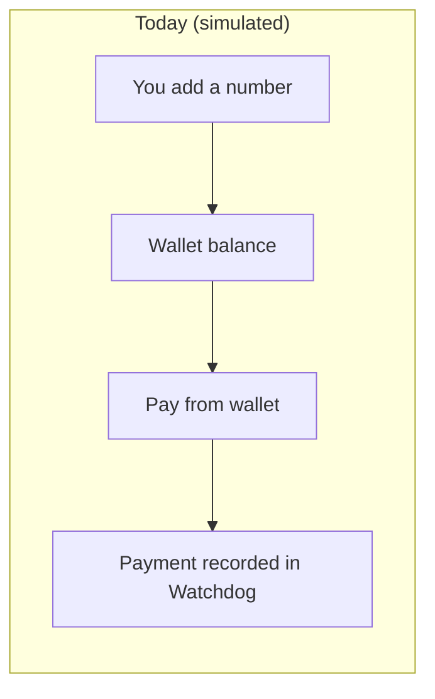
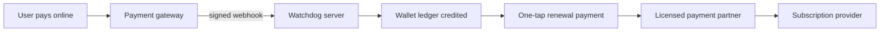
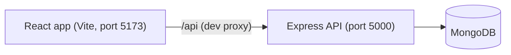

<div align="center">

# Watchdog

### Your subscriptions, under control.

Track every recurring payment, see what is about to be charged, understand where the money goes, and never be surprised by a renewal again.


</div>

---

## The problem

Open your bank statement and count the small charges you do not remember agreeing to.

A streaming service you stopped watching. A cloud plan that quietly renewed for a year. A free trial that was never free. Individually they are small. Together they are a real monthly number that most people have never actually added up.

Subscriptions are designed to be easy to start and easy to forget. **Watchdog is built to be the opposite: easy to see.**

## What Watchdog does

You add your subscriptions once. Watchdog then answers the questions you actually care about:

| Question | Where you get the answer |
|---|---|
| What am I paying every month, and every year? | **Overview** and **Analytics** |
| What is about to be charged, and when? | **Overview**, **Calendar** |
| Did I already pay this one? | **Subscriptions** (Mark as paid) |
| Where is my money going? | **Analytics** (category, plan and cost charts) |
| Is anything worth cancelling? | **Insights** and **Savings Planner** |
| Can I afford the next month of renewals? | **Wallet** and **Savings Planner** |

It is a multi-page web app with sign in and sign out, a dark-first design, and a light theme if you prefer it. It works on desktop, tablet and phone.

---

## A 60-second tour

1. **Sign up** and sign in. Passwords are hashed and your data is private to your account.
2. Open **Settings, then Data management, then Load demo data** to fill the app with ten clearly labelled sample subscriptions (you can remove them in one click).
3. **Overview** shows your monthly spend, projected yearly spend, active subscriptions, renewals due in 7 days, an upcoming-charges chart and a "waiting for you" card for renewals you have not marked as paid.
4. **Subscriptions** lets you search, filter, sort and switch between card and table views. Click any subscription for its full details.
5. **Calendar** shows every renewal in month, week or agenda view, with paid and unpaid dates marked.
6. **Analytics** breaks your spending down by category, billing frequency and plan.
7. **Insights** flags things worth a second look: a costly service, a busy renewal week, a price increase, a possible overlap.
8. **Savings Planner** lets you set a budget, try "what if I cancelled these?" scenarios, and track a savings goal.
9. **Wallet** keeps a balance you can use to mark renewals as paid.
10. Press **Ctrl + K** (or Cmd + K) anywhere to search everything.

---

## Features in depth

### Subscription management
- Add, edit, pause, mark as cancelled, and delete subscriptions.
- Billing frequencies: weekly, monthly, quarterly, yearly, or a custom number of days.
- Quick-add presets (Netflix, Spotify, Prime Video and more), logos or icons, colours, categories, notes, payment method and per-subscription reminders.
- A live preview shows the monthly and yearly cost while you fill in the form.
- Card view and table view, with filters for All, Active, Upcoming, Due today, Unpaid, Paused and Cancelled.

### Mark as paid, without guessing
Most trackers assume a renewal happened. Watchdog does not. **You** confirm it.

- **Mark as paid** records the payment. Paying an upcoming renewal moves the next date forward by one billing cycle.
- If a renewal date passes and you have not marked it, it becomes **unpaid** instead of silently disappearing. You will see it as a badge, a red entry on the calendar, a notification, and a card on the dashboard.
- For each unpaid renewal you can **mark it as paid** or **skip** it.
- Made a mistake? **Undo** the latest payment. The renewal date (or the unpaid state) is restored.
- Every payment is stored with the date you paid, the amount, a note, and whether it was recorded manually or from the wallet.

### Calendar
Month, week and agenda views. Scheduled charges, estimated future repeats, payments you confirmed, and unpaid renewals each look different. The side panel totals what is due in the next 7, 30 and 90 days.

### Analytics
Spending by category, by billing frequency and by subscription; renewals per week; recorded history over time; and a "Payments you confirmed" section that only counts what you actually marked as paid. Everything can be filtered by date range and category, and exported to CSV.

### Insights
Automated, rule-based insights, each with an explanation, a financial impact and a suggested next step. You can dismiss, snooze or resolve them.

- **High cost:** one subscription is a large share of your recurring spend.
- **Renewal cluster:** many charges land in the same week.
- **Overlap review:** services you tagged as doing the same job.
- **Price increase:** based on prices you recorded.
- **Plan comparison:** only when you entered an alternative price yourself.
- **Review reminder:** a subscription you have not reviewed in 90 days.
- **Budget warning:** you are over or close to your monthly budget.

### Savings Planner
Set a monthly (and optional yearly) budget and see how your commitments compare. Use the **what-if calculator** to simulate cancelling a subscription or switching its billing plan, and see the monthly and yearly effect. These are simulations: **nothing is changed** until you choose to change it yourself. You can also set a savings goal such as "cut recurring spending by 15%" and track progress.

### Settings and data
Profile, light/dark/system theme, currency, number and date formats, time zone, notification switches, password change, CSV export and import (with validation and duplicate skipping), demo data, and a full reset.

---

## The Wallet

> **Honest status: the wallet is a simulated balance today. It is just a number.**

### What it does right now
- Holds a balance in one currency, shown in the top bar and on its own page.
- You can **add money** or **remove money** (the balance can never go below zero).
- From any subscription you can choose **Pay from wallet**. This lowers the balance and records a payment, advancing the renewal date exactly like Mark as paid.
- Every movement is written to a **ledger**: top-ups, payments, refunds and removals, each with the balance afterwards.
- Undoing a wallet payment **refunds** the wallet automatically.
- Payments are protected against race conditions: if two payments compete for the same balance, only one can succeed.
- It tells you whether your balance covers the next 30 days of scheduled charges.

### What it does not do (yet)
Adding money does not charge anyone, and paying from the wallet does **not** send money to Netflix, Spotify or anyone else. It records a payment that you confirm. The app says this clearly on the wallet page and in the payment dialog, so nobody is misled.

### The idea: from a number to a real payment desk
The wallet is deliberately built as a **ledger**, so real money can be plugged in later without redesigning anything.





What is already in place for that future:

- Every wallet transaction already stores a `provider` and a `providerRef` field. Today they say `manual`. A gateway such as Razorpay, Stripe or Cashfree could fill them in when a real payment succeeds.
- Balance changes are atomic and ledger-backed, which is exactly what you want when real money is involved.
- Each payment records its source (`manual` or `wallet`), so reports can separate them.

A sensible path to get there:

| Phase | What happens | Status |
|---|---|---|
| 0 | Simulated wallet and ledger | Done |
| 1 | Real top-ups through a payment gateway (test mode first), using signed and idempotent webhooks | Not started |
| 2 | One-tap "pay now" handoff for due renewals, for example UPI deep links or auto-pay mandates where the provider supports them | Not started |
| 3 | A licensed partner holds funds and pays bills, so the wallet can truly settle subscriptions | Not started |

**A realistic note on "paying subscriptions directly":** services like Netflix or Spotify do not accept payments pushed from third-party sites. The usual routes are UPI AutoPay and e-mandates, bill-payment networks, or virtual cards, and each has its own rules. Holding or moving other people's money is also regulated (for example, RBI rules for prepaid wallets in India), so a real launch typically needs a licensed partner. Check with a payments provider or a lawyer before taking real money.

---

## How the numbers work

Watchdog tries to never give you a number it cannot justify.

- **Monthly equivalent:** weekly x 52 / 12, monthly x 1, quarterly / 3, yearly / 12, custom = price x (365 / days) / 12. A Rs 1,200 yearly plan counts as Rs 100 per month.
- **Only active subscriptions count.** Paused and cancelled ones are excluded from totals.
- **No currency conversion.** Totals add up active subscriptions in your display currency. Subscriptions in other currencies are listed but left out of the totals, and the app says so. Watchdog never invents exchange rates.
- **Projections are labelled as projections.** Annualized and future figures assume your plans continue unchanged, and are never presented as money already spent.
- **Scheduled vs estimated.** The next billing date you saved is "scheduled". Later repeats worked out from the billing cycle are "estimated".
- **History is recorded, not invented.** The history charts use monthly snapshots Watchdog saves while you use it. Nothing is back-filled. Price history is recorded when you change a price in Watchdog.
- **"Mark as cancelled" only changes tracking inside Watchdog.** It does not cancel anything with the provider, and the app reminds you of that.
- **Insights are rules, not magic.** There is no AI model reading your bank or email. Every insight comes from your own data and says which rule produced it.
- **Notifications are in-app only.** No emails or push messages are sent.

---

## Tech stack

| Layer | Technology |
|---|---|
| Frontend | React 18, Vite, React Router, Axios, Lucide icons |
| Charts | Hand-built SVG components (no charting library) |
| Backend | Node.js, Express |
| Database | MongoDB with Mongoose (browse it in MongoDB Compass) |
| Auth | JWT sessions (7 days), passwords hashed with bcryptjs |
| Language | JavaScript throughout |



### Project structure

```
25070521016/
├── README.md
├── server/                 Express API
│   ├── index.js            app entry, routes, database connection
│   ├── models/             User, Subscription, Snapshot, WalletTx
│   ├── routes/             auth, subscriptions, settings, analytics, wallet
│   ├── middleware/         JWT auth
│   └── utils/              dates, finance maths, validation, wallet, demo data
└── client/                 React app
    └── src/
        ├── pages/          Dashboard, Subscriptions, Calendar, Analytics,
        │                   Insights, Savings, WalletPage, Settings, Login, Register
        ├── components/     layout, charts, UI building blocks, dialogs, drawers
        ├── context/        auth, data, toasts, UI state
        ├── hooks/          overlays, click-outside, subscription actions
        └── utils/          calculations, formatting, insights, notifications, CSV
```

---

## Getting started

You need **Node.js** (LTS recommended) and **MongoDB** running locally. MongoDB Compass is optional but handy for looking at your data.

**1. Check MongoDB is running**
Open Compass and connect to `mongodb://localhost:27017`.

**2. Start the backend**
```bash
cd server
npm install
npm run dev
```
If there is no `server/.env` yet, copy `.env.example` to `.env` and set `JWT_SECRET` to a long random string. You should see `MongoDB connected` and `Server running on http://localhost:5000`.

**3. Start the frontend** (in a second terminal)
```bash
cd client
npm install
npm run dev
```

**4. Open** http://localhost:5173, create an account, and explore. Load the demo data from **Settings, then Data management** if you want it pre-filled.

### Configuration (`server/.env`)

| Variable | Meaning | Default |
|---|---|---|
| `PORT` | API port | `5000` |
| `MONGO_URI` | MongoDB connection string | `mongodb://127.0.0.1:27017/subscription_watchdog` |
| `JWT_SECRET` | Secret used to sign login tokens. Keep it private. | none |

### Where your data lives
Database `subscription_watchdog`, with these collections: `users`, `subscriptions_v2`, `snapshots` and `wallettxes`. They appear as you use the app.

---

## API overview

All routes except register and login need an `Authorization: Bearer <token>` header. Every record is scoped to the signed-in user.

| Area | Routes |
|---|---|
| Auth | `POST /api/auth/register`, `POST /api/auth/login`, `GET /api/auth/me`, `PUT /api/auth/profile`, `PUT /api/auth/password` |
| Subscriptions | `GET/POST /api/subscriptions`, `PUT/DELETE /api/subscriptions/:id`, `PATCH /:id/status`, `POST /:id/review` |
| Payments | `POST /api/subscriptions/:id/pay`, `POST /:id/pay/undo`, `POST /:id/skip` |
| Import and demo | `POST /api/subscriptions/import`, `POST/DELETE /api/subscriptions/demo`, `DELETE /api/subscriptions?confirm=yes` |
| Wallet | `GET /api/wallet`, `POST /api/wallet/topup`, `POST /api/wallet/withdraw` |
| Settings | `GET/PUT /api/settings` |
| Analytics | `GET /api/analytics/history` |

---

## Design principles

- **Calm and clear.** A dark-first interface with one accent colour, generous spacing and no clutter.
- **Honest by default.** If Watchdog does not know something, it says so instead of guessing.
- **You stay in control.** Destructive actions ask first. What-if tools never change real data.
- **Accessible.** Keyboard navigation, focus handling in dialogs, labelled controls and reduced-motion support.
- **Responsive.** Tables become cards on small screens, and navigation collapses into a menu.

---

## Known limitations

- The wallet is simulated. No real money moves anywhere.
- No email verification or password reset yet.
- The login token is stored in the browser's local storage, which is simple but not the most hardened option.
- No rate limiting on the API yet, and CORS is set up for local development.
- Billing dates on the 29th to 31st can shift by a day after passing through a short month.
- Totals only include subscriptions in your display currency.
- There are no automated tests in the repository yet.

## Roadmap ideas

- Real wallet top-ups through a payment gateway, using signed webhooks.
- UPI deep links and auto-pay mandates for one-tap renewals.
- Email and push reminders.
- Password reset and email verification.
- Shared household accounts.
- Installable app (PWA) and receipt attachments.
- An automated test suite and CI.

---

## Troubleshooting

| Problem | Fix |
|---|---|
| `Failed to resolve import "lucide-react"` | Run `npm install` inside `client`. |
| `MongoDB connection failed` | Start the MongoDB service (on Windows: `services.msc`, then start **MongoDB Server**). |
| Port 5000 already in use | Change `PORT` in `server/.env` and the proxy target in `client/vite.config.js`. |
| Old subscriptions are missing after updating | Newer versions store subscriptions in `subscriptions_v2`. Old records stay in the old `subscriptions` collection and can be dropped in Compass. |
| Odd install or build errors | Install the Node.js LTS release, delete `node_modules`, and run `npm install` again. |

---

## About

Watchdog started as a simple question: *what if looking after your subscriptions felt as easy as checking the weather?* It grew from a small tracker into a full multi-page product with payments tracking, insights, planning and a wallet designed to grow into real payments.

Built by **Bhavya Agrawal** (project `25070521016`) with React, Node.js and MongoDB.

If you made it this far, thank you for reading. If Watchdog helps you spot even one subscription you forgot about, it has done its job.
